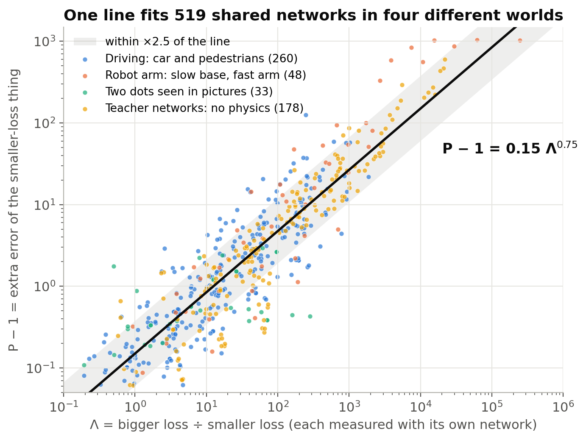
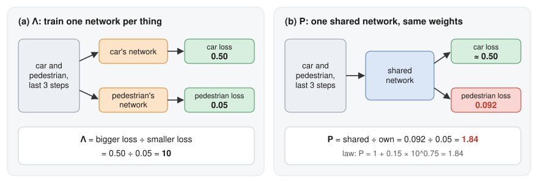
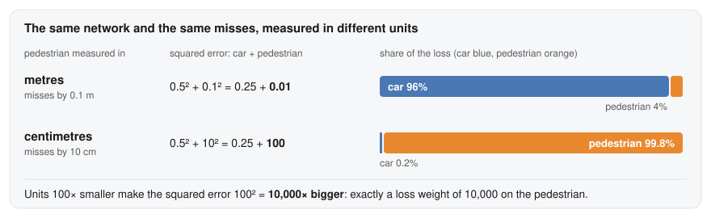
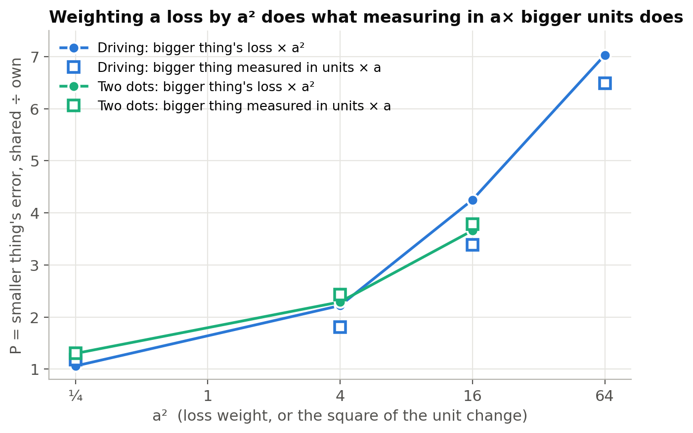
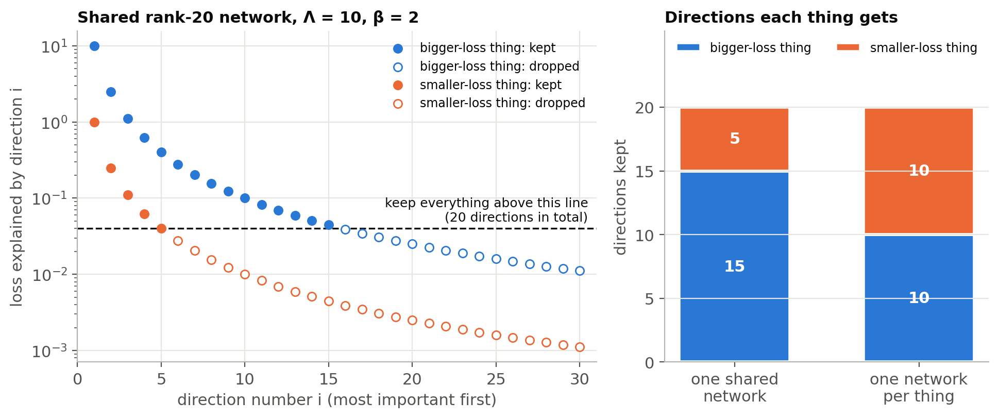
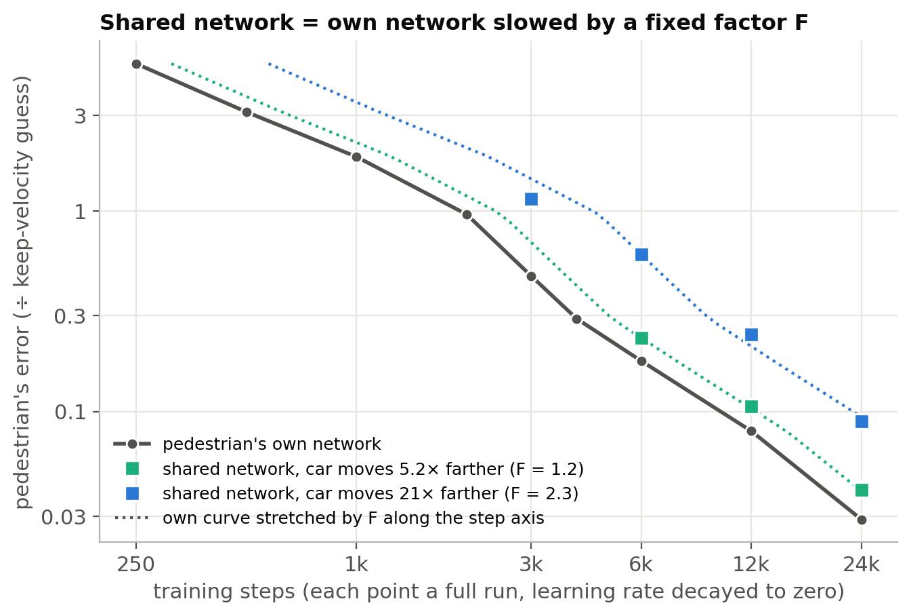
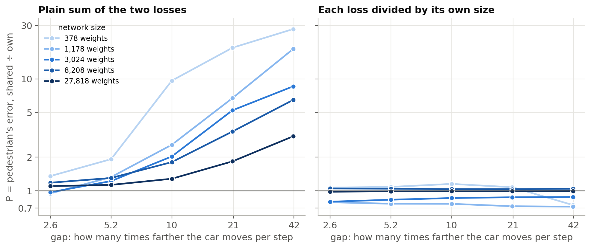
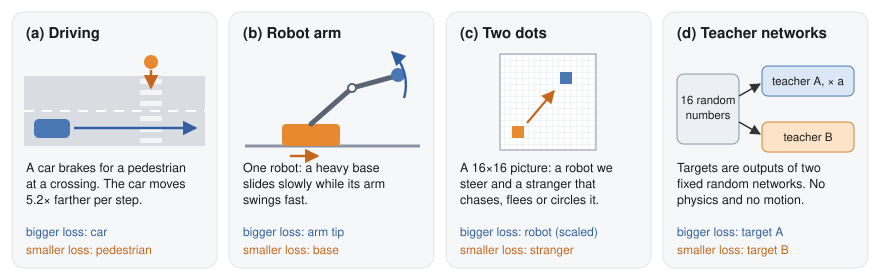

# Training one network on two losses added together hurts the thing with the smaller loss

We are using this work to write a conference paper. Code, data and text are free to use under the MIT licence.

## Abstract

**Many networks are trained on two losses added together.** A self-driving model predicts a fast car and a slow pedestrian. A mixture-of-experts language model adds a router balancing loss to its next-token loss.

**The thing with the smaller loss is learned worse** than it would be by its own network with the same total number of weights. Here "loss" is that thing's squared error, measured on its own.

**One number predicts how much worse: the loss ratio Λ,** the bigger loss divided by the smaller one, each measured with its own network. The smaller thing's extra error is about 0.15 × Λ^0.75. A loss 10 times bigger makes its error 1.8 times larger; 100 times bigger, about 6 times larger.

**The cause is the sum itself.** The bigger term produces most of the gradient and takes most of the shared weights. Multiplying a loss by a² does the same as measuring that thing in units a times bigger.

**Dividing each loss by its own size, or giving each thing its own network, removes it.** Training longer does not, and a bigger network helps only once the separate networks stop gaining from size.

> [!IMPORTANT]
> Across 519 shared networks in four different worlds (driving, a robot arm, two dots seen in pictures, and random teacher networks with no physics), one line fits: **P − 1 ≈ 0.15 Λ^0.75**, within ×2.5 in 31 of 35 settings. P is the smaller-loss thing's error in the shared network ÷ its error in its own network.

---

## Measure the loss ratio before you add two losses together

Λ is easy to measure: train one small network per term, compare their final losses. Λ = 10 predicts P ≈ 1.8; Λ = 100 predicts P ≈ 5.7. A world with no physics at all (two random teacher networks) falls on the same line as driving, so the rule is about the loss, not about motion.

> **The size of each term in the sum, not what it means, decides how much the smaller term is neglected.**

## Treat a change of units as a loss weight

| a² | Driving, loss × a² | Driving, units × a | Dots, loss × a² | Dots, units × a |
|---|---|---|---|---|
| 4 | 2.22 | 1.81 | 2.29 | 2.43 |
| 16 | 4.25 | 3.39 | 3.66 | 3.78 |

> **Measuring one thing in centimetres instead of metres is the same as weighting its loss by 10,000.**

This is also a theorem: at the best weights of any network, raising one loss's weight can only lower that loss and raise the other. For a shared linear network with limited capacity, the harm is P = ((1 + Λ^(1/β)) / 2)^(β−1), which grows slower than Λ and does not depend on the network's size ([paper, section 7](paper/paper.html#s7)). The network keeps the directions worth the most loss, so the bigger-loss thing takes most of them:

## Do not expect longer training to fix it

| P at 6k / 12k / 24k steps | |
|---|---|
| Driving, car 21× the pedestrian's move | 3.39 / 3.04 / 3.08 |
| Two dots, robot target ×4 | 3.78 / 3.82 / 3.70 |

> **The shared network learns the smaller thing a fixed factor slower from start to end, so the ratio of the errors stays the same.**

## Do not expect a bigger network to fix it while the separate networks still gain from size

The same teacher, trained for 300 steps (own error barely improves with size) and for 3,000 steps (own error keeps falling): P falls with size from 1.94 to 1.21 in the first case and rises from 1.78 to 4.10 in the second ([chart](figures/size.png)).

> **More weights help the smaller thing only when it has stopped needing them itself.**

## Divide each loss by its own size

Dividing each thing's loss by its own typical size removed the effect of the gap: P − 1 exceeded 0.1 in 1 of 25 driving runs. One network per thing also removes it, when each part is big enough and sees what its thing reacts to.

---

## Where it stops working

> [!WARNING]
> All misses fall below the line. A GRU sits ×0.12 below it; a smaller-loss target that its own network barely learns sits ×0.19–0.40 below. Depth and the optimizer move the constant (depth 4 ×2.4, Muon ×1.7). A constant learning rate makes the harm look up to 3× larger, so compare designs after the learning rate has decayed. Networks here are up to 142,000 weights; large models are untested.

## Is this new?

The effect itself is known: with squared error, a target at a bigger scale swamps a smaller one ([Khakhar & Buckman, 2022](https://arxiv.org/abs/2211.07447)), and normalizing each target fixes it ([PopArt](https://arxiv.org/abs/1809.04474)). [Fernandes et al. (ICML 2023)](https://arxiv.org/abs/2302.09650) showed that a multilingual model acts like a single-language model with a fraction of the weights, set by each language's share of the data. What is new here is the law from the loss ratio alone, the same-size test, the rank-k formula and the fixed slowdown.

| Work | Rebalances losses | Same-size test against one network per term | Predicts the harm from one number |
|---|---|---|---|
| Khakhar & Buckman 2022 (targets at different scales) | no (histogram loss) | no | no |
| Fernandes et al. 2023 (multilingual scaling laws) | data share | yes, as effective weights | from the data share, fitted per language pair |
| GradNorm, uncertainty weighting, PCGrad, PopArt | yes | no | no |
| Driving and robot world models (Scene Transformer, UniAD, GAIA-1, DreamerV3) | some (symlog, per-action scaling) | no | no |
| Mixture-of-experts and multi-token prediction (Switch Transformer, DeepSeek-V3) | fixed small weights | no | no |
| **This repo** | per-term scaling | **yes** | **yes, P − 1 ≈ 0.15 Λ^0.75** |

Untested predictions for large systems (pedestrians in driving models, router balance in mixture-of-experts models, multi-token prediction heads) are in [section 13 of the paper](paper/paper.html#s13).

## Setup

Four small worlds, MLPs (depth 1–4), GRUs and a few transformers from 360 to 142,000 weights, Adam with the learning rate decayed to zero, 3,000–24,000 steps. Every shared network is compared with one network per thing at equal total weights. Each run takes 2–9 seconds on a laptop CPU.

- [paper/paper.html](paper/paper.html): the full paper, with proofs
- [RESULTS.md](RESULTS.md): every table, the commands and the knobs
- [LAB-NOTES.md](LAB-NOTES.md): raw notes with predictions written before each run
- [toy/](toy/): the four worlds, the fits and every run (`*.jsonl`); [charts.py](charts.py) draws every figure

MIT licence.
